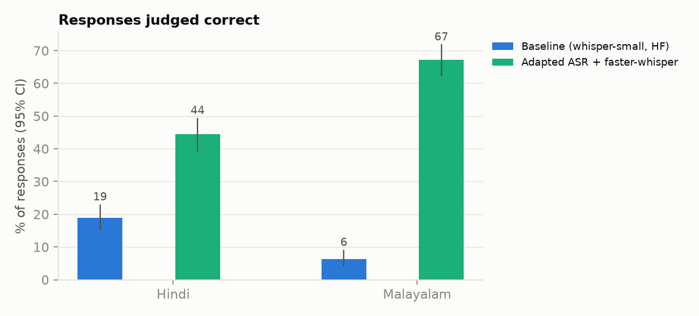
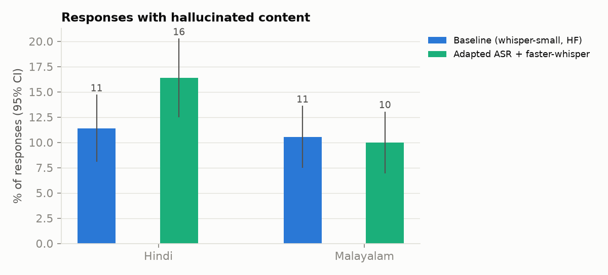
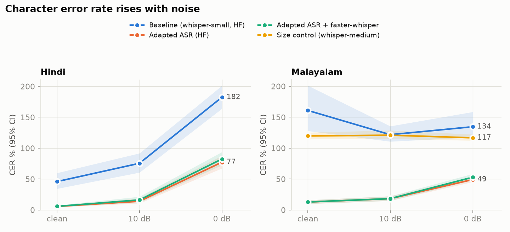
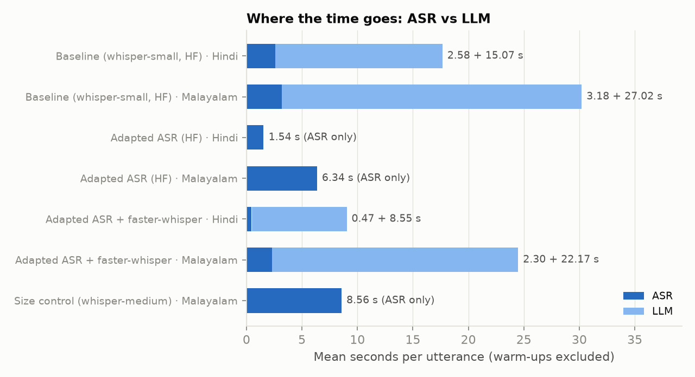
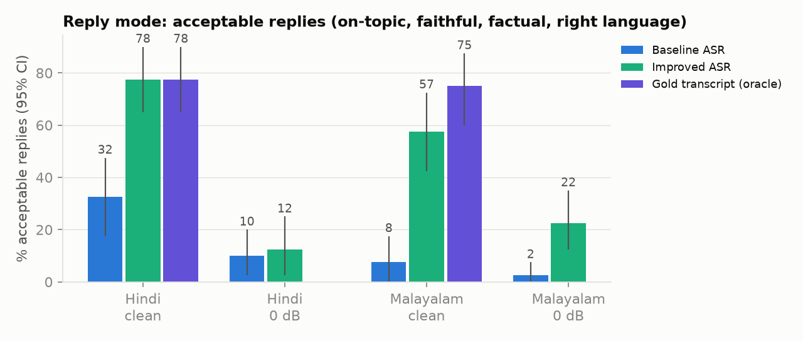

# Indic Speech → ASR → LLM → Text Response: Implementation, Evaluation and Ablation

**Languages:** Hindi (`hi_in`), Malayalam (`ml_in`) · **Data:** Google FLEURS test split · **Hardware:** RTX 3060 Laptop (6 GB), Windows 11
**Evaluated items:** 720 for ASR and restatement (120 utterances × 2 languages × 3 acoustic conditions); 400 replies for reply mode (160 per ASR system + 80 oracle); 720 for language ID · Code and reproduction steps: [README.md](README.md) · Design log: [PLAN.md](PLAN.md)
Auto-generated tables with all confidence intervals: [results/summary.md](results/summary.md)

---

## 1. Summary

| | Baseline | Improved | Change |
|---|---|---|---|
| ASR CER, Hindi (pooled) | 101.2% | 34.8% | −66.4 pts [−76.5, −57.2] |
| ASR CER, Malayalam (pooled) | 139.0% | 27.9% | −111.1 pts [−127.5, −96.3] |
| Responses judged correct, Hindi | 18.9% | 44.4% | +25.6 pts [+20.0, +31.4] |
| Responses judged correct, Malayalam | 6.4% | 67.2% | +60.8 pts [+55.3, +66.1] |
| Hallucination rate (judge), Hindi | 11.4% | 16.4% | +5.0 pts [+0.0, +10.0], p = 0.054 |
| Hallucination rate (judge), Malayalam | 10.6% | 10.0% | −0.6 pts [−5.0, +3.6], p = 0.84 |
| ASR real-time factor, Hindi / Malayalam (mean) | 0.239 / 0.234 | 0.042 / 0.169 | 5.7× / 1.4× faster |
| **Reply mode:** acceptable replies, Hindi clean / Malayalam clean | 32.5% / 7.5% | 77.5% / 57.5% | +45.0 / +50.0 pts (p < 0.001) |
| **Reply mode:** acceptable replies, Malayalam 0 dB | 2.5% | 22.5% | +20.0 pts [+7.5, +35.0] |
| **Native-speaker rating:** replies rated a good response / on-topic (blind, 24 paired utterances) | 12% / 12% | 42% / 46% | +29 pts (p < 0.001) / +33 pts (p = 0.002) |

*Baseline* = stock `openai/whisper-small` (HF transformers). *Improved* = language-adapted Whisper checkpoints served with faster-whisper (CTranslate2). Both feed the same LLM (`Qwen3-4B-Instruct-2507`, 4-bit). Brackets are paired-bootstrap 95% CIs on the same items.

**Main findings**
1. **ASR is the bottleneck.** When the LLM is given the gold transcript, 99.2% of responses are correct, and 99–100% of the baseline's failures disappear (§6.1).
2. **Language adaptation removes most of it.** Malayalam CER falls from 139% to 28%. A size control (stock whisper-medium) shows that this comes from adaptation, not model size: the control only reaches 119% CER (§6.3).
3. **faster-whisper makes the adapted ASR 2.7–3.3× faster** at the same accuracy (within 1–2.5 CER points), after we fixed a silent truncation bug in its decoder.
4. **At 0 dB SNR, better ASR increases hallucination.** The adapted ASR produces *partial* transcripts, and the LLM, told to repair misrecognised words, fills the gaps with invented content. Hindi 0 dB goes from 4.2% to 39.2% (§6.2). This is now the main remaining quality problem.
5. **The LLM is now the latency bottleneck.** It takes 8.5 s (Hindi) and 22 s (Malayalam) per utterance against ≤ 2.3 s for ASR, because 4-bit decoding runs at ~12 tok/s and Malayalam text is token-heavy (§6.4).
6. **Reply mode: on clean Hindi the improved system matches the gold-transcript ceiling** (77.5% acceptable replies, the same as the oracle). Replies are now limited by the LLM itself: even with a perfect transcript it asks the user to repeat in 22.5% of Hindi replies and misstates what was said in ~15–17% (§6.5).
7. **Blind native-speaker ratings confirm the reply gains** (good responses 12% → 42%, on-topic 12% → 46%). The LLM judge agrees moderately with the human on relevance (κ = 0.52) and on overall response quality (κ = 0.46; Hindi 0.57, Malayalam 0.25), so it is a usable but imperfect proxy, weakest for Malayalam (§6.7).
8. **Automatic language identification is 97.5% accurate** (100% on clean speech), adding ~0.1 s; its only weak spot is Malayalam at 0 dB, misheard as Hindi in 13% of cases (§6.6).

---

## 2. Task definition: two response modes, and why both

The system takes speech in Hindi or Malayalam and returns a text response **in the same language and script** (never English). The LLM runs in two modes, with prompts in [`src/llm.py`](src/llm.py):

- **Restatement** (diagnostic layer): restate faithfully what the user said, repairing words that look misrecognised, without adding anything. This answers the question *did the system understand what was said?*
- **Reply** (product layer): reply to the user as an assistant would, in 1–3 sentences. This answers *did it respond well?* It is the user-facing output the brief asks for.

**Why both are evaluated.** Understanding and responding fail in different ways and need different evaluation. Understanding has a gold answer (what was actually said), so restatement measures it **objectively**: CER of the restatement, correctness against two references, and an oracle attribution that proves where errors come from. A reply has no single gold answer, so it is measured with a **grounded rubric plus native-speaker human ratings** (§5.3, §5.4). A reply metric alone couldn't separate "misheard the user" from "responded badly"; restatement can. Restatement alone wouldn't show whether the user gets a useful answer; reply does.

**Why restatement is the primary objective measure:**
- **Correctness becomes objectively measurable.** The brief asks for *response correctness and hallucination rate with clearly defined criteria*. A conversational reply has no gold answer, so it could only be graded by an unvalidated rubric. For a restatement, every FLEURS utterance comes with two references: the native-script transcript and a professional English translation (FLoRes). That lets us define *correct* and *hallucinated* against ground truth rather than opinion.
- **It isolates the effect of the ASR improvement on the response.** The LLM's job is fixed, so any change in response quality between runs comes from the ASR, which is what the research extension changes.
- **It's still a real response.** The LLM has to interpret noisy, partly wrong recognition output and produce clean text. That's the first step of any spoken assistant (understanding what the user said), and it's where ASR errors turn into wrong or invented content.
- **It reveals a real failure mode.** §6.2 shows that over-eager repair under noise produces hallucinations. A task without a reference couldn't measure this.

Both modes use the same ASR transcripts, so reply results can be compared directly with restatement results.

---

## 3. Data and conditions

- **Source:** FLEURS test split for `hi_in` and `ml_in` (raw TSV and audio downloaded directly from the HF repo). The English gold is the `en_us` transcript of the same FLoRes sentence id.
- **Sample:** 120 distinct sentences per language, fixed seed, stratified by speaker gender (Hindi 60/60; the Malayalam test speakers are all female, so gender is **not** used as a condition).
- **Conditions (2 axes):**
  - *Linguistic:* Hindi (Indo-Aryan) vs Malayalam (Dravidian, agglutinative, much lower-resource for Whisper).
  - *Acoustic:* clean, **10 dB** and **0 dB** SNR. Noise is babble (4 other FLEURS speakers) plus 30% white noise. Each utterance gets the *same* noise sample at both SNRs, so loudness is the only difference. The measured SNR of the rendered files is 10.00 ± 0.002 dB and 0.00 ± 0.000 dB.
- **Total:** 240 utterances × 3 conditions = **720 items**, in `data/manifest.csv`, shared by every run.

---

## 4. Pipeline

```
speech (16 kHz) ─► language ID ─► Whisper ASR (per language) ─► transcript ─► Qwen3-4B-Instruct (4-bit NF4) ─► restatement or reply (same language)
```

- **Language ID** ([`src/lid.py`](src/lid.py)). One decoder step of stock `whisper-medium`, with a softmax over only the `<|hi|>` and `<|ml|>` tokens, so it can't choose a language we have no ASR for. It selects the per-language ASR checkpoint. In the batch evaluation the language is known from the manifest; language ID is evaluated separately (§6.6) and used by the single-file demo, [`scripts/demo.py`](scripts/demo.py).

- **ASR backends** ([`src/asr.py`](src/asr.py)). HF transformers and faster-whisper sit behind one `transcribe()` interface. Both use greedy decoding, a forced language token, `<|notimestamps|>`, one 30 s window and a 440-token budget, so runs differ only in weights or engine.
- **LLM** ([`src/llm.py`](src/llm.py)). `Qwen/Qwen3-4B-Instruct-2507`, bitsandbytes 4-bit, greedy and deterministic: reruns gave byte-identical outputs. The token cap is 30 tokens per second of audio + 32. Reference text peaks at 22.3 tokens per speech-second, so correct answers are never truncated and copied ASR loops can't run on.
- **Runner** ([`src/pipeline.py`](src/pipeline.py)). ASR runs on all items, then the LLM on all items, because both models don't fit together in 6 GB. Results are appended to JSONL item by item, and every stage resumes after an interruption.

---

## 5. Evaluation methodology (our own infrastructure)

All metric code is in [`src/metrics/`](src/metrics) and [`src/stats.py`](src/stats.py), covered by 19 known-answer unit tests ([`tests/test_metrics.py`](tests/test_metrics.py)).

### 5.1 ASR
| Metric | Definition | Why |
|---|---|---|
| **WER / CER** | Corpus-level: total edit errors ÷ total reference words (chars). Both sides normalised identically: Unicode NFC → indic-nlp normaliser (unifies the two encodings of Malayalam chillu letters; nuktas kept) → punctuation incl. `।` stripped → whitespace collapsed. | Whisper's `BasicTextNormalizer` deletes Indic combining marks (vowel signs, virama), which makes Indic WER meaningless, so it is deliberately not used. **CER is primary for Malayalam**: it is agglutinative, so one suffix error makes a whole long word wrong and WER over-penalises. |
| **Degenerate-output rate** | Share of transcripts that are word loops (> 50% repeated words), character loops (≥ 20 chars from ≤ 3 distinct characters) or runaway (> 2× reference length). | Whisper's dominant failure on Malayalam and on noise is *looping*. WER > 100% shows that something is wrong but not what; this metric shows it. |

### 5.2 Response correctness and hallucination
Each response is compared with two references: the **native transcript** (surface form) and the **English gold** (meaning).

| Metric | Definition |
|---|---|
| **Judge label** (primary) | LLM judge (`Qwen2.5-7B-Instruct`, 4-bit, greedy), shown the native reference, the English meaning and the response. **correct**: in the target language and conveys every key element (who, what, entities, numbers, places, times); paraphrase allowed. **partial**: main idea kept, ≥ 1 key element missing or wrong. **incorrect**: main idea missing or wrong, unrelated, empty, or not in the target language. Reported as % correct and as a partial-credit score (1 / 0.5 / 0). Unparseable judge output is scored *incorrect* and counted (baseline 10/720, improved 1/720). |
| **Hallucination (judge)** (primary) | True if the response states a specific detail (name, number, event, place, attribute) that is **not stated or implied by the reference**. Omissions and garbled words are *not* hallucination; they count against correctness. The judge also returns the invented span. |
| **Hallucination (lexical)** | Numbers in the response that appear in neither reference, with Devanagari and Malayalam digits mapped to ASCII. An independent, judge-free cross-check: high precision, low recall. |
| **Runaway rate** | Response > 1.5× reference length: the LLM copying an ASR loop. Reported separately, not counted as hallucination, because a copied loop is a correctness failure rather than invented content. |
| **Response CER, chrF++** | Response vs native transcript. Response CER vs ASR CER shows whether the LLM repairs or adds surface errors. |
| **LaBSE similarity** | Cosine similarity of language-agnostic sentence embeddings, response vs English gold: meaning preserved regardless of wording. |
| **Off-script rate** | < 80% of letters in the target script (English output, or Devanagari in a Malayalam answer). |

**Judge validation.** [`scripts/label_sample.py`](scripts/label_sample.py) exports 40 random items for hand-labelling under the same definitions and reports Cohen's κ per label. The sheet is at `results/improved/human_labels.csv`. It is sampled from the improved run because baseline responses are almost all *incorrect*, which would make agreement trivially high. **The hand labels have not been filled in yet, so the judge numbers below are unvalidated** (§7).

### 5.3 Reply mode: grounded rubric (LLM judge)
There is no single gold reply, so every criterion is judged against **what the user actually said** (gold transcript plus English meaning). The judge never sees the ASR transcript, so a reply built on a misrecognition counts as a failure.

| Criterion | Definition |
|---|---|
| **Relevance** | **on_topic**: engages with the actual subject and content of what was said · **partial**: right general topic but responds to a detail that wasn't said · **off_topic**: responds to something else (e.g. a misrecognised topic) |
| **Misattribution** | The reply says or implies the user said something they didn't, *in a way that changes the meaning*. Paraphrasing is not misattribution, and the judge must quote the misattributed part or answer false. |
| **Factual hallucination** | The reply asserts a specific factual claim that is false or contradicts what was said. **Correct added background knowledge is not hallucination.** The judge first names the most doubtful claim, then decides. |
| **Asks to repeat** | The reply asks the user to repeat or clarify. Reported separately: appropriate after failed ASR, a weakness when the transcript was fine. |
| **Off-script** | < 80% of letters in the target script (automatic). |
| **Acceptable** (headline) | on_topic **and** no misattribution **and** no factual hallucination **and** in-script |
| **LaBSE(reply, English gold)** | Judge-free relevance signal: a reply should be semantically related to what was said. |

**Rubric calibration.** Two problems surfaced on a small sample and were fixed before final scoring:
1. The judge counted correct background facts as hallucination (5/12 on a 12-item smoke test).
2. It flagged faithful paraphrases as misattribution (2 of 4 inspected cases had an empty span).

It also failed to produce parseable JSON on 14/400 items, mostly long Malayalam spans; a larger output budget and a field-level fallback parser brought that to 0. Judge caches are keyed by a hash of the prompt, so edits to the rubric can't reuse stale verdicts. Because the rubric was tuned on items from the evaluation set, the native-speaker ratings (§5.4) are the independent check.

### 5.4 Reply mode: blind native-speaker evaluation
A native speaker of both Hindi and Malayalam rates a **blind, paired sample**: 6 utterances per language × {clean, 0 dB} = 24 utterances, each with its baseline and improved reply, so **48 replies**. The rows are shuffled and system identity is hidden, with the key stored in a separate file. Script: [`scripts/human_eval.py`](scripts/human_eval.py). Guide: [`results/human_eval/GUIDE.md`](results/human_eval/GUIDE.md).

| Criterion | Scale and anchors |
|---|---|
| **Correctness (response quality)** | Is this a good, correct response to what was actually said? correct (a useful reply that responds correctly) / partial (reasonable attempt, but part of it is wrong, misstated or unhelpful) / incorrect (wrong, misstated, nonsense, or a **non-answer** such as "I didn't understand, please repeat") |
| **Relevance** | on_topic / partial / off_topic, with the same definitions as the judge |
| **Understandability** | 1–5: 5 fluent and native-like · 4 clear, minor awkwardness · 3 understandable with effort · 2 hard to understand · 1 incomprehensible or wrong language. It rates the language itself, independently of correctness. |

Reported: % good responses (rated `correct`), % on-topic and mean understandability per system × language × condition, with bootstrap CIs; the paired improved − baseline difference; and **Cohen's κ between the human and the LLM judge**, overall and per language: relevance against the judge's relevance label, and response quality against the judge's overall **acceptable** verdict, the comparable construct. Understandability is human-only: an LLM judge can't reliably assess native-speaker naturalness, especially in Malayalam.

**How the correctness criterion was applied.** The original guide counted a pure request to repeat as *correct* (no false claim). The annotator instead rated *correctness* as overall response quality: is this a good response? Non-answers were rated incorrect, and this was applied consistently (all 17 replies the judge flagged as asking to repeat were rated incorrect or partial). The ratings were kept as given, and the criterion is reported under the definition actually applied; a note in `GUIDE.md` records the change. Hallucination was not rated separately by the human.

The annotator rated all 48 replies blind. One entry had a value outside its scale (relevance = "correct"); the annotator was asked and corrected it to "partial". Results are in §6.7.

### 5.5 Latency
- **Per-stage timing:** `time.perf_counter()` with `torch.cuda.synchronize()` around ASR, LLM time-to-first-token (timed at the first generated **token** via a streamer hook; the stock text streamer only emits at word boundaries and misreported space-free output) and LLM total.
- **RTF = processing time ÷ audio duration**, for ASR and end to end (ASR + LLM; model load/unload excluded).
- The first 3 items of each language × SNR group are warm-ups and excluded. Mean, p50 and p90 are reported.
- Timed runs ran one at a time, with nothing else on the GPU.

### 5.6 Statistics
- **95% confidence intervals** for every metric by language × SNR, using an utterance-level bootstrap (2,000 resamples). Ratio metrics such as WER are recomputed as corpus ratios inside each resample.
- **Baseline vs improved** uses a **paired** bootstrap on the same items, with a two-sided p-value.

---

## 6. Results

### 6.1 Baseline by condition, and where its errors come from

| Lang | SNR | CER % | Degenerate % | Correct % | Halluc. (judge) % | ASR RTF |
|---|---|---|---|---|---|---|
| Hindi | clean | 45.9 [34.3, 59.8] | 7.5 | 37.5 [29.2, 46.7] | 10.8 | 0.168 |
| Hindi | 10 dB | 75.4 [60.6, 91.7] | 15.8 | 16.7 [10.0, 24.2] | 19.2 | 0.196 |
| Hindi | 0 dB | 182.3 [163.8, 201.0] | 63.3 | 2.5 [0.0, 5.8] | 4.2 | 0.352 |
| Malayalam | clean | 160.9 [127.8, 201.1] | 41.7 | 7.5 [3.3, 12.5] | 11.7 | 0.186 |
| Malayalam | 10 dB | 121.7 [110.7, 135.4] | 52.5 | 6.7 [2.5, 11.7] | 15.0 | 0.236 |
| Malayalam | 0 dB | 134.5 [117.4, 158.5] | 70.8 | 5.0 [1.7, 9.2] | 5.0 | 0.280 |

Stock whisper-small effectively can't transcribe Malayalam. It emits repetition loops (`ḍḍḍ…`, `ഹൊ ഹൊ…`), English *translations* ("In this video, I will show you…"), or Hindi tokens, even with the decoder forced to `<|ml|><|transcribe|>`. CER above 100% comes from these runaway insertions.

**Bottleneck identification (oracle ablation).** The same LLM given the **gold transcript** is judged correct on **99.2%** of utterances in both languages, with 0% hallucination (Hindi) and 0.8% (Malayalam). Of the baseline's incorrect or partial responses, **99–100% become correct** with the gold transcript, and **100%** of its hallucinations disappear. **ASR is the bottleneck**, by a wide margin.

### 6.2 Improved system: response quality




| Lang | SNR | ASR CER % | Correct % | Halluc. (judge) % | Response CER % | LaBSE |
|---|---|---|---|---|---|---|
| Hindi | clean | 5.8 | 80.0 | 0.8 | 10.0 | 0.79 |
| Hindi | 10 dB | 16.2 | 50.0 | 9.2 | 20.5 | 0.72 |
| Hindi | 0 dB | 82.3 | 3.3 | **39.2** | 76.4 | 0.34 |
| Malayalam | clean | 12.8 | 93.3 | 0.0 | 17.4 | 0.78 |
| Malayalam | 10 dB | 18.2 | 79.2 | 6.7 | 26.0 | 0.71 |
| Malayalam | 0 dB | 52.8 | 29.2 | **23.3** | 56.6 | 0.40 |

- **Clean and 10 dB are solved to a useful level.** Malayalam clean goes from 7.5% to **93.3%** correct, and Hindi clean from 37.5% to **80.0%**. Hallucination on clean speech drops to ≤ 1%. Off-script output falls from 2.8% to 0%.
- **0 dB: hallucination rises.** With baseline ASR, 0 dB transcripts were loops, and the LLM copied them back (wrong, but not invented: runaway rate 62–65%). With adapted ASR, 0 dB transcripts are *partially* right, and the LLM, following its instruction to repair misrecognised words, **completes them with plausible invented content**. Example `hi_in_1933_0`: the ASR gives `अंत में तेई ऐसी छोटे बिल्डन लोजपे टैक्स एक्स एक्स एक्स…`; the LLM drops the loop and writes `अंत में तीन ऐसे छोटे बिल्डिंग लोजपे टैक्स लोग हैं` ("three small buildings… tax people"). The reference is about small cats eating prey. The judge's flagged span was `तीन ऐसे छोटे बिल्डिंग लोजपे टैक्स लोग`. This is why pooled Hindi hallucination rises (+5.0 pts, p = 0.054) even as correctness more than doubles.
- **The LLM paraphrases more than it repairs.** Its response CER is higher than its input ASR CER (Hindi clean 5.8% → 10.0%). It cuts character errors on 16.9% of items and adds them on 55.8%. Some of that is harmless rewording: even on gold transcripts its response CER is 5–6%, the oracle floor. Real repairs do occur. For example, `hi_in_1720_clean` ASR `फ़लों का जूज` → LLM `फलों का जूस` ("fruit juice").

### 6.3 Research extension: ablations

| Run (only the ASR changes) | Hindi CER % | Malayalam CER % | Hindi ASR RTF | Malayalam ASR RTF |
|---|---|---|---|---|
| Baseline: whisper-small, HF | 101.2 | 139.0 | 0.239 | 0.234 |
| Size control: stock whisper-**medium**, HF | — | 119.0 | — | 0.663 |
| Adapted ASR, HF engine | 32.3 | 26.7 | 0.137 | 0.462 |
| **Adapted ASR + faster-whisper** (improved) | 34.8 | 27.9 | **0.042** | **0.169** |

Adapted checkpoints: `vasista22/whisper-hindi-small` (same size as the baseline), and `vrclc/Whisper-medium-Malayalam` (never trained on FLEURS, so a true held-out test).



- **Accuracy comes from adaptation, not size.** On Malayalam, scaling stock Whisper from small to medium cuts CER by only 20.0 pts [−35.4, −5.7] and nearly triples ASR time. The adapted medium cuts a further **91.1 pts** [−95.6, −86.2] below the stock medium.
- **Speed comes from the engine.** On the same adapted weights, faster-whisper cuts ASR RTF **3.3× (Hindi) and 2.7× (Malayalam)**. CER changes by +2.5 and +1.2 pts, a small cost from fp16 kernel numerics.
- **The combination fixes both problems.** The Hindi model is the same size as the baseline, so the improved system is both far more accurate and 5.7× faster. For Malayalam, faster-whisper more than pays for the larger adapted model (ASR RTF 0.169 vs the baseline's 0.234).
- All baseline vs improved differences in CER and correctness have p < 0.001 (paired bootstrap). Full tables are in [results/summary.md](results/summary.md).

### 6.4 Latency



| Run | Lang | ASR s (p50) | LLM TTFT s (p50) | LLM s (p50) | End-to-end s (p50) | End-to-end RTF (p50) |
|---|---|---|---|---|---|---|
| Baseline | Hindi | 1.58 | 0.19 | 9.39 | 10.98 | 1.01 |
| Baseline | Malayalam | 4.88 | 0.21 | 23.64 | 28.35 | 2.45 |
| Improved | Hindi | 0.42 | 0.18 | 7.84 | 8.25 | 0.82 |
| Improved | Malayalam | 2.21 | 0.22 | 14.72 | 16.97 | 1.25 |

n = 351 timed items per language (3 warm-ups per language × SNR group excluded). The figure shows means.

- **The LLM dominates latency (85–95% of end-to-end time).** Time-to-first-token is only ~0.2 s, so a streaming interface would *feel* responsive. Full generation is slow because bitsandbytes 4-bit decodes at ~12 tok/s on this GPU (measured peak memory 2.76 GiB, so this is decode speed, not memory spill), and Malayalam needs ~14 Qwen3 tokens per second of speech vs ~10 for Hindi.
- Baseline latency is inflated by loops. Looped transcripts make the LLM copy up to its cap, so better ASR also cuts Malayalam p50 LLM time by ~38% (23.6 → 14.7 s).
- **The next bottleneck is LLM decode speed**, not ASR (§8).

---

### 6.5 Reply mode



| ASR | Lang | SNR | ASR CER % | Acceptable % | On-topic % | Misattrib. % | Factual halluc. % | Asks to repeat % |
|---|---|---|---|---|---|---|---|---|
| Baseline | Hindi | clean | 37.4 | 32.5 [17.5, 47.5] | 35.0 | 20.0 | 2.5 | 45.0 |
| Baseline | Hindi | 0 dB | 194.6 | 10.0 [2.5, 20.0] | 10.0 | 17.5 | 0.0 | 77.5 |
| Baseline | Malayalam | clean | 161.4 | 7.5 [0.0, 17.5] | 15.0 | 17.5 | 0.0 | 25.0 |
| Baseline | Malayalam | 0 dB | 123.4 | 2.5 [0.0, 7.5] | 2.5 | 5.0 | 0.0 | 52.5 |
| Improved | Hindi | clean | 4.0 | **77.5** [65.0, 90.0] | 85.0 | 10.0 | 5.0 | 12.5 |
| Improved | Hindi | 0 dB | 92.4 | 12.5 [2.5, 25.0] | 15.0 | 27.5 | 0.0 | 55.0 |
| Improved | Malayalam | clean | 12.2 | **57.5** [42.5, 72.5] | 80.0 | 25.0 | 0.0 | 10.0 |
| Improved | Malayalam | 0 dB | 58.1 | **22.5** [12.5, 35.0] | 27.5 | 15.0 | 0.0 | 12.5 |
| Gold transcript (oracle) | Hindi | — | 0.0 | 77.5 [65.0, 90.0] | 90.0 | 17.5 | 0.0 | 22.5 |
| Gold transcript (oracle) | Malayalam | — | 0.0 | 75.0 [60.0, 87.5] | 90.0 | 15.0 | 0.0 | 5.0 |

n = 40 per row. Off-script replies: baseline 0% (Hindi) and 6.2% (Malayalam), improved 0%. Full paired tests are in [results/summary.md](results/summary.md).

- **Better ASR makes replies useful.** On clean speech, acceptable replies rise by **+45.0 pts** in Hindi and **+50.0 pts** in Malayalam, and on-topic replies by +50 and +65 pts (all p < 0.001). At 0 dB, Malayalam improves by +20.0 pts (p = 0.004); Hindi 0 dB doesn't improve significantly (+2.5, p = 0.84), matching its 92% ASR CER.
- **The baseline mostly couldn't respond.** It asked the user to repeat in 45–78% of Hindi replies. Where it did reply, it often answered a *misrecognised* topic. Example `hi_in_1698_clean`: the user says "Everything in the Universe is made of matter; all matter is made of tiny particles called atoms." The baseline ASR garbles it, and the reply says it isn't clear what the user means. With the improved ASR the reply opens "हां, सही है…" ("Yes, that's right…") and engages.
- **On clean Hindi, ASR is no longer the bottleneck.** The improved system reaches the gold-transcript ceiling (77.5% vs 77.5%). Malayalam clean still has a gap (57.5% vs 75.0%), driven by its higher ASR CER and misattribution.
- **The ceiling is set by the LLM's reply behaviour.** Even with a perfect transcript, Qwen3-4B asks the user to repeat in 22.5% of Hindi replies and misstates what was said in 15–17%. It often reacts to plain factual statements with doubt ("are you sure…", "which event do you mean?").
- **The judge misses factual nonsense.** The improved reply to `hi_in_1698_clean` continues with an invented phrase about "expression molecules or boron molecules" (`अभिव्यक्ति अणुओं या बोरन अणुओं`), yet the judge marked it acceptable. Factual-hallucination rates near 0% are therefore likely an **under-estimate**. The human evaluation rated overall response quality, not hallucination separately, so the judge's hallucination labels remain unvalidated.
- **Latency:** replies are longer than restatements (p50 LLM time 14.5 s Hindi, 23.3 s Malayalam for the improved system), so the LLM remains the latency bottleneck.

### 6.6 Automatic language identification

| Language | Clean | 10 dB | 0 dB |
|---|---|---|---|
| Hindi | 100% | 100% | 100% |
| Malayalam | 100% | 98.3% [95.8, 100] | 86.7% [80.8, 92.5] |

All 720 items; overall **97.5%** [96.4, 98.5]; p50 0.10 s per utterance (RTF 0.008). Every error is Malayalam at 0 dB detected as Hindi, which suggests a prior bias towards the higher-resource language under heavy noise. Stock whisper-small was tried first: 70.0% on Malayalam 0 dB (whisper-medium 86.7%), so whisper-medium was chosen, at ~65 ms more per utterance. This choice was made on the test data, so these accuracies are slightly optimistic. A wrong language call routes the audio to the wrong ASR model, so at 0 dB the end-to-end demo loses roughly another 13% of Malayalam utterances beyond the §6.5 numbers, which assume the language is known.

### 6.7 Native-speaker evaluation

Blind, paired ratings by a native speaker of both languages (§5.4): 24 utterances × {baseline, improved} = 48 replies. Brackets are bootstrap 95% CIs; with n = 6 per cell, the per-condition rows are indicative only. Generated by `scripts/human_eval.py analyze`; full output in [results/human_eval/results.md](results/human_eval/results.md).

| System | Language | Condition | Good response % | On-topic % | Understandability (1–5) |
|---|---|---|---|---|---|
| Baseline | both | all (n = 24) | 12 [0, 25] | 12 [0, 29] | 4.29 [3.83, 4.67] |
| Baseline | Hindi | clean | 50 | 50 | 5.00 |
| Baseline | Hindi | 0 dB | 0 | 0 | 4.33 |
| Baseline | Malayalam | clean | 0 | 0 | 3.00 |
| Baseline | Malayalam | 0 dB | 0 | 0 | 4.83 |
| Improved | both | all (n = 24) | **42** [21, 62] | **46** [25, 67] | 3.79 [3.25, 4.29] |
| Improved | Hindi | clean | 67 | 67 | 4.50 |
| Improved | Hindi | 0 dB | 33 | 33 | 4.00 |
| Improved | Malayalam | clean | 50 | 67 | 4.33 |
| Improved | Malayalam | 0 dB | 17 | 17 | 2.33 |

**Improved − baseline, paired on the same utterances:** good responses **+29 pts** [+12.5, +50.0], p < 0.001 · on-topic **+33 pts** [+12.5, +54.2], p = 0.002 · understandability −0.50 [−1.25, +0.25], p = 0.20 (not significant).

**Agreement between the human and the LLM judge (Cohen's κ):**

| Criterion | All | Hindi | Malayalam |
|---|---|---|---|
| Relevance (3-level) | **0.52** | 0.53 | 0.50 |
| Response quality (human `correct` vs judge `acceptable`) | **0.46** | 0.57 | 0.25 |

Raw agreement on response quality is 77%. Of the 17 replies the judge flagged as asking the user to repeat, the human rated 14 incorrect and 3 partial.

**Findings**
- **The human ratings confirm the main result.** Improved ASR makes replies far more often good and on-topic. This is independent evidence, not just the LLM judge agreeing with itself.
- **The judge is a moderate proxy for a native speaker.** κ = 0.52 on relevance and 0.46 on overall response quality is "moderate" agreement on the usual Landis–Koch scale (0.41–0.60). It is clearly weaker for Malayalam (κ = 0.25 on quality), consistent with Qwen2.5-7B reading Malayalam less reliably than Hindi. The judge-based rates in §6.5 are therefore trustworthy as trends, and the human ratings are the reference.
- **Non-answers are what users experience as failures.** The human rated every "please repeat" reply as a failed response. The baseline's high clarification rate (45–78% in Hindi, §6.5) is therefore a real quality problem, not a safe fallback, and reducing it is a large part of the improvement.
- **Hallucination was not human-rated.** Because the human scored overall quality, the judge's misattribution and factual-hallucination labels are neither confirmed nor refuted here; the factual-nonsense example in §6.5 suggests the judge under-counts hallucination.
- **Understandability falls where the improved system engages with garbled input.** The drop is concentrated in Malayalam at 0 dB (4.83 → 2.33). There the improved ASR yields partly correct transcripts, and the LLM **copies garbled pseudo-words from them into its reply** (e.g. `പുരാവനചേമകതെരുന്നത്തിന്നും…`, `സാപ്രിക്ക് വളരെ ചുവാകാവിരുക്കാൻ…`, rated 1). The baseline's replies in that condition were mostly fluent requests to repeat: easy to read, but useless. Understandability and usefulness are therefore distinct; the prompt-level fix is to tell the LLM not to reuse words it can't recognise (§8).
- Baseline Malayalam clean also scores low on understandability (3.00), consistent with its replies being built on whisper-small's English or Hindi-script mistranscriptions.

---

## 7. Limitations

- **Reply judge: moderate agreement, hallucination unvalidated.** The reply judge's wording was corrected after inspecting a few items from the evaluation set (§5.3). It agrees moderately with the human on relevance (κ = 0.52) and overall quality (κ = 0.46, only 0.25 for Malayalam). Its hallucination and misattribution labels were not human-rated and likely under-count hallucination.
- **Correctness criterion applied as response quality.** The human rated correctness as overall response quality (non-answers = incorrect) rather than the guide's narrower factual definition; reported as applied (§5.4).
- **Human evaluation scale.** One annotator (native speaker of both languages, who is also the project author; ratings were blind to system), 48 replies; per-condition cells have n = 6. A second annotator would allow inter-annotator agreement to be measured.
- **Scope of reply evaluation.** The reply prompt's "1–3 sentences" limit means multi-step instructions are out of scope; multi-step instruction following was not evaluated.
- **The restatement judge is unvalidated.** Agreement with human labels (Cohen's κ) has not been measured; the 40-item sheet is ready but unfilled. Spot checks suggest the judge is somewhat **lenient**. For example, it labelled baseline `hi_in_1720_clean` (`अद चोकलेट… फलुका जूस माहिंगा`) *correct*, though "hot" and "fruits" are garbled. Qwen2.5-7B also reads Malayalam less reliably than Hindi, and a Qwen model grading a Qwen model may carry family bias. The judge-free metrics (CER, LaBSE, lexical check) point the same way, which supports the conclusions, but the absolute judge percentages should be treated as estimates.
- **Whisper's 448-token decoder limit.** Whisper's byte-level tokenizer needs ~2.2 tokens per Malayalam character, so one window holds ~200 characters. The longest Malayalam sentences can't be fully transcribed by any Whisper model here, which puts a floor under Malayalam CER. Audio over 30 s (2 utterances = 6 items) is truncated to 30 s by every engine, the same as `WhisperProcessor` does.
- **Timing noise.** A few 2–6 s Windows sleep events happened during the baseline and improved LLM stages. Each could inflate at most one item's timing, so we report p50/p90, which are robust to a handful of outliers.
- **In-domain advantage.** The Hindi adapted model was trained on FLEURS train+dev (sentence-disjoint from test, so no leakage), which may flatter its FLEURS numbers. The Malayalam adapted model never saw FLEURS.
- **Scope.** FLEURS is read speech. Conversational, accented or code-mixed speech would be harder. The Malayalam sample is single-gender.

---

## 8. Future work

1. **Curb repair-induced hallucination at low SNR.** Expose ASR confidence to the LLM, or tell it to leave unintelligible spans unrepaired and mark them; then measure the trade-off between correctness and hallucination.
2. **LLM decode speed.** A faster 4-bit engine (llama.cpp / GGUF, or ExLlama), or an Indic-efficient tokenizer, would attack the now-dominant latency.
3. **Noise robustness.** Noise-augmented fine-tuning for the 0 dB condition, where even the adapted ASR is at 53–82% CER.
4. **Better reply behaviour.** Reduce needless requests to repeat and misattribution with the gold transcript, and stop the LLM from copying unrecognisable words into replies under noise (prompting, or a stronger Indic LLM), since this is now the reply-quality ceiling. A stronger judge for Malayalam (κ = 0.25 on quality), and a separate human rating of hallucination, would tighten the reply evaluation.
5. **Multi-step instruction following** on spoken instructions, with per-step checklists.
6. **Language-ID robustness** at low SNR (e.g. a prior correction, or combining LID with ASR confidence), and a second annotator for the human evaluation.

---

## 9. Reproduction

See [README.md](README.md). In short: `scripts/prepare_data.py` → `scripts/run_queue.sh` (restatement runs, scoring, report) → `scripts/eval_lid.py` → `scripts/run_reply_queue.sh` (reply runs and rubric scoring) → `scripts/human_eval.py export|analyze` → `scripts/make_report.py`. Try a single recording with `scripts/demo.py`. Raw per-item outputs for every run are in `results/<run>/{asr,llm,predictions,scored}.jsonl`.
